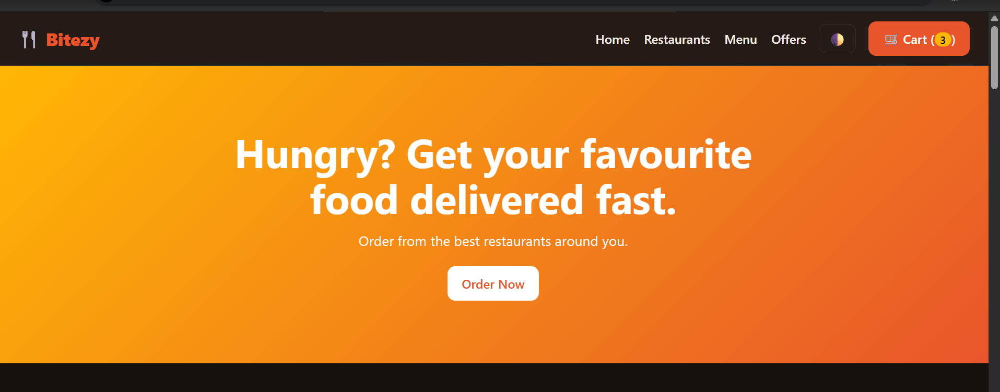

# 🍴 Bitezy: Food Delivery System

A responsive food delivery website where users can browse restaurants,
explore menus, build a cart and place an order online.
Built for the Sqrock IT Solutions Web Development Internship (Phase 2).

**Live demo:** [add your link here]



## Features

- Responsive homepage with hero, categories, offers and featured food
- Restaurant listing with rating, delivery time and open/closed status
- Food menu with 6 categories
- Search by name, category filter, price filter and sorting
- Shopping cart: add, remove, change quantity, clear, live totals
- Checkout form with validation
- Order confirmation page with order summary
- Dark mode, mobile menu and cart saved in LocalStorage

## Technologies

HTML5, CSS3 (Grid, Flexbox, CSS variables) and vanilla JavaScript (ES6).

## Project structure

```
food-delivery/
├── index.html
├── css/style.css
├── js/app.js
└── screenshots/
```

## Run locally

1. Clone the repo: `git clone https://github.com/[your-username]/food-delivery.git`
2. Open `index.html` in your browser. No installation is needed.

## What I learned

- Rendering UI from data with `map`, `filter` and `sort`
- Managing state and keeping the screen in sync with the data
- Event delegation for dynamically created buttons
- Form validation and protecting against XSS with escaped input
- Responsive design with CSS Grid and media queries

## Author

[Your name] · [LinkedIn link] · [GitHub link]